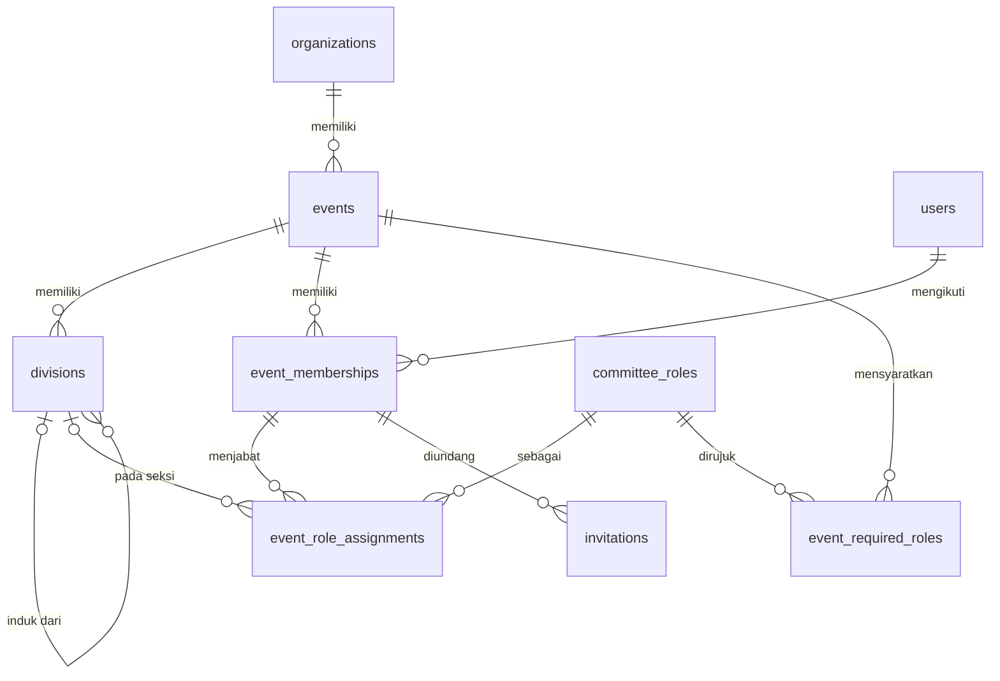
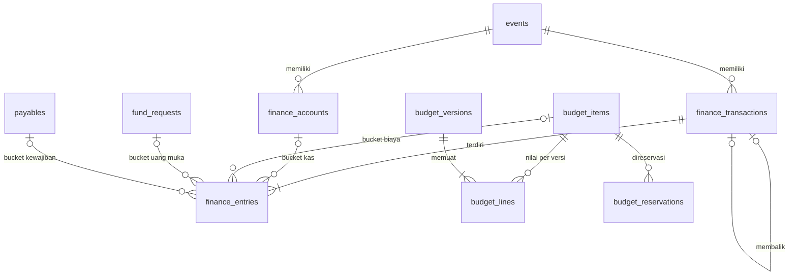

# Organizer — Data Model (usulan)

**Status:** Usulan Phase 0, bukan migration final. Nama tabel dan kolom dapat disesuaikan saat implementasi tiap batch.
**Sumber requirement:** [organizer.md](organizer.md) bagian 9
**Dokumen pendamping:** [IMPLEMENTATION_PLAN.md](IMPLEMENTATION_PLAN.md), [DEVELOPMENT_TRACKER.md](DEVELOPMENT_TRACKER.md)

Dokumen ini memuat konvensi skema, entitas per domain beserta kolom kuncinya, kardinalitas, constraint, dan batch tempat setiap tabel dibuat. Kolom yang tercantum adalah kolom penentu desain; kolom deskriptif biasa tidak didaftar seluruhnya.

---

## 1. Tabel yang sudah ada

| Tabel | Asal | Perlakuan |
|---|---|---|
| `users` | Laravel + Jetstream, diperluas K-15 | Direktori semua orang. `username`, `email`, `password` opsional; ditambah `phone` (unik), `organization_unit_id`, `status` (`active`/`inactive`), `notes`. Kolom `current_team_id` tidak dipakai |
| `password_reset_tokens`, `sessions` | Laravel | Tetap |
| `roles`, `permissions`, `model_has_roles`, `model_has_permissions`, `role_has_permissions` | spatie-permission | Dipakai untuk otorisasi tingkat organisasi |
| `personal_access_tokens` | Sanctum | Tetap, tidak dipakai modul baru |
| `cache`, `cache_locks`, `jobs`, `job_batches`, `failed_jobs` | Laravel | Tetap |
| `audit_logs` | Organizer, Batch 1.0 | Lihat bagian 7.3 |
| `organizations`, `organization_units`, `committee_roles`, `committee_role_abilities`, `division_templates`, `event_categories`, `venues` | Organizer, Batch 1.1 | Lihat bagian 3 |

---

## 2. Konvensi

| Hal | Konvensi |
|---|---|
| Primary key | `id` bigint unsigned auto-increment, mengikuti tabel yang ada |
| Foreign key | `foreignId()->constrained()`. Default `restrictOnDelete`. `cascadeOnDelete` hanya untuk baris anak dari record yang masih draft |
| Scope | `organization_id` pada tabel tingkat organisasi; `event_id` pada semua tabel berscope event, termasuk tabel anak yang sering difilter atau diindeks per event |
| Konsistensi scope | Untuk relasi berisiko tinggi (assignment ke seksi, baris anggaran ke seksi, tugas ke seksi), child memakai foreign key komposit `(division_id, event_id)` ke `divisions(id, event_id)` sehingga database sendiri menolak seksi dari event lain. Relasi lain divalidasi di Action dan dites |
| Status dan tipe | Kolom `string` yang di-cast ke enum PHP. Tidak memakai tipe ENUM database agar kompatibel dengan MySQL dan SQLite |
| Uang | `bigint` dalam satuan terkecil mata uang, sufiks `_amount`. Mata uang di `events.currency_code` (default `IDR`) |
| Quantity | `decimal(12,3)` |
| Waktu | `timestamp` disimpan UTC. Tanggal murni memakai `date` dengan sufiks `_on`; waktu memakai sufiks `_at` |
| Pelaku | `created_by` dan `updated_by` (FK `users`, nullable) pada tabel bisnis |
| Soft delete | Master data tidak memakai soft delete: record dinonaktifkan lewat `is_active` atau `status`, dan hanya bisa dihapus bila tidak dirujuk (foreign key `restrictOnDelete` yang memutuskan). Soft delete hanya untuk record kerja yang wajar dipulihkan (`documents`, `tasks`). Tidak ada soft delete pada transaksi terposting, keputusan approval, dan snapshot final |
| Relasi polimorfik | Hanya untuk lampiran, komentar, sumber tugas, target approval, dan audit. Daftar tipe dibatasi lewat `Relation::enforceMorphMap` di `AppServiceProvider` (aktif sejak Batch 1.0). Model baru didaftarkan dengan alias pendek; `User` tetap memakai nama kelasnya karena baris spatie dan Sanctum yang ada sudah menyimpannya begitu. Relasi inti keuangan selalu memakai foreign key nyata |
| Referensi publik | Token acak yang disimpan dalam bentuk hash untuk undangan dan check-in. Bukan pengganti otorisasi |

---

## 3. Identitas dan organisasi (Batch 1.1, sudah dibuat)

Semua tabel di bagian ini, kecuali `committee_role_abilities`, memiliki `created_by` dan `updated_by` (FK `users`, `nullOnDelete`) serta timestamps.

| Tabel | Kolom kunci | Constraint |
|---|---|---|
| `organizations` | `name`, `short_name`, `timezone` (default `Asia/Jakarta`), `currency_code` (default `IDR`), `address`, `city`, `phone`, `email`, `website`, `is_active` | Baseline satu baris; organisasi "saat ini" adalah baris pertama |
| `organization_units` | `organization_id`, `parent_id`, `name`, `description`, `is_active` | `(organization_id, name)` unik; induk dari organisasi yang sama; tanpa siklus (validasi); `parent_id` `restrictOnDelete` |
| ~~`users`~~ | Dibuat di Batch 1.1, dihapus di K-15 | Isinya pindah ke `users` (bagian 1) |
| `committee_roles` | `organization_id`, `key`, `name`, `kind`, `scope` (`event`/`division`), `description`, `is_required_default`, `is_singleton_default`, `sort_order`, `is_active` | `(organization_id, key)` dan `(organization_id, name)` unik |
| `committee_role_abilities` | `committee_role_id`, `ability` | Pasangan unik; ikut terhapus bersama jabatannya |
| `division_templates` | `organization_id`, `name`, `description`, `default_responsibilities`, `is_active` | `(organization_id, name)` unik |
| `event_categories` | `organization_id`, `name`, `description`, `is_active` | `(organization_id, name)` unik |
| `venues` | `organization_id`, `name`, `address`, `capacity`, `notes`, `is_active` | `(organization_id, name)` unik |

Catatan:
- Semua orang, dengan atau tanpa akses login, ada di `users` (K-15). Seseorang bisa login bila statusnya aktif dan username serta password-nya terisi.
- Email dan username disimpan huruf kecil, dan nomor telepon disimpan tanpa spasi atau tanda baca, sehingga pemeriksaan duplikat tidak terkecoh format.
- `committee_roles.kind` (`chair`, `deputy`, `secretary`, `treasurer`, `supervisor`, `division_coordinator`, `division_member`, `custom`) adalah klasifikasi struktural agar aturan pemisahan kewenangan bisa diterapkan tanpa meng-hardcode ID atau nama jabatan. Jabatan bawaan (selain `custom`) dibuat otomatis saat organisasi dibuat; `key`, `kind`, dan `scope`-nya tidak dapat diubah dan jabatannya tidak dapat dihapus.
- `committee_roles.key` untuk jabatan tambahan dibentuk dari namanya dan dijamin unik per organisasi.
- `committee_role_abilities.ability` berisi nilai enum `App\Enums\EventAbility`. Default-nya mengikuti matriks di [IMPLEMENTATION_PLAN.md](IMPLEMENTATION_PLAN.md) bagian 7 dan dapat diubah admin. Jabatan berjenis `supervisor` hanya boleh memegang ability baca dan pencatatan keputusan.
- Belum dibuat dan ditunda sampai ada pemakainya: `organizations.locale`, identitas dokumen organisasi (Batch 2.1), dan `division_templates.type_key` (Phase 3).

---

## 4. Event dan kepanitiaan (Batch 1.2, sudah dibuat)

Yang benar-benar dibuat berbeda dari usulan awal di bawah dalam tiga hal: aturan jabatan per event bernama `event_role_rules` (kolom `is_required`, `is_singleton`, tanpa `max_holders`); tabel `invitations` ditunda (undangan dijawab di aplikasi lewat status keanggotaan); riwayat status bernama `event_status_histories`. Keunikan penugasan aktif dan pemegang utama ditegakkan database lewat kolom `active_key` dan `primary_key` yang terisi selama penugasan aktif. Keanggotaan dan seksi pada penugasan, serta induk seksi, memakai foreign key komposit `(id, event_id)` sehingga tidak bisa merujuk event lain.

| Tabel | Kolom kunci | Constraint |
|---|---|---|
| `events` | `organization_id`, `event_category_id`, `venue_id`, `organization_unit_id`, `code`, `name`, `theme`, `subtheme`, `description`, `background`, `target_participants`, `starts_on`, `ends_on`, `committee_starts_on`, `committee_ends_on`, `location_text`, `budget_target_amount`, `currency_code`, `status`, `phase`, `responsible_user_id`, `cloned_from_event_id`, `settings` (json), `activated_at`, `closed_at`, `archived_at` | `(organization_id, code)` unik; `ends_on >= starts_on` |
| `event_objectives` | `event_id`, `type` (`goal`/`target`/`indicator`), `description`, `target_value`, `unit`, `actual_value`, `sort_order` | – |
| `event_status_history` | `event_id`, `from_status`, `to_status`, `from_phase`, `to_phase`, `reason`, `actor_user_id`, `created_at` | Append-only |
| `event_required_roles` | `event_id`, `committee_role_id`, `is_required`, `max_holders` (nullable) | `(event_id, committee_role_id)` unik |
| `divisions` | `event_id`, `parent_id`, `division_template_id`, `name`, `description`, `responsibilities`, `status`, `starts_on`, `ends_on`, `sort_order` | `(event_id, name)` unik; `(id, event_id)` unik untuk FK komposit; induk dari event yang sama, tanpa siklus |
| `event_memberships` | `event_id`, `user_id`, `status` (`invited`/`active`/`declined`/`revoked`), `invited_at`, `accepted_at`, `revoked_at`, `revoked_reason` | `(event_id, user_id)` unik |
| `event_role_assignments` | `event_id`, `event_membership_id`, `committee_role_id`, `division_id` (nullable), `is_primary`, `job_description`, `starts_at`, `ends_at`, `ended_reason`, `assigned_by` | Tidak ada duplikat aktif untuk kombinasi membership + jabatan + seksi; seksi dari event yang sama |
| `invitations` | `user_id`, `event_membership_id` (nullable), `email`, `token_hash`, `expires_at`, `accepted_at`, `revoked_at`, `sent_by` | `token_hash` unik |

Catatan:
- `events.status`: `draft`, `active`, `completed`, `cancelled`, `archived`. `events.phase`: `initiation`, `formation`, `planning`, `preparation`, `final_readiness`, `execution`, `evaluation`, `reporting`. Status menentukan apa yang boleh diubah; phase bersifat informatif dan tidak memaksa urutan linear.
- `event_required_roles` adalah salinan aturan jabatan per event, diisi dari default `committee_roles` saat event dibuat. Mengubah master jabatan tidak mengubah event yang sedang berjalan.
- Unik pada `event_role_assignments` melibatkan kolom nullable (`division_id`) dan hanya berlaku untuk baris aktif, sehingga tidak bisa diandalkan lewat indeks unik biasa. Usulan: kolom tergenerasi `active_key` yang bernilai gabungan membership–jabatan–seksi saat `ends_at` kosong dan `NULL` saat berakhir, dengan indeks unik di atasnya; ditambah pengecekan di Action.
- Gate jabatan wajib, batas pemegang (`max_holders`), dan larangan siklus seksi ditegakkan di Action di dalam transaksi.
- Pencabutan akses dilakukan dengan mengisi `revoked_at` pada membership; `EventAccess` hanya membaca membership `active` dan assignment yang `ends_at`-nya kosong.

---

## 5. Perencanaan, sekretariat, koordinasi (Batch 1.3–1.8)

### 5.1 Program kerja dan tugas (Batch 1.3)

| Tabel | Kolom kunci | Constraint |
|---|---|---|
| `work_programs` | `event_id`, `division_id` (nullable), `title`, `objective`, `output`, `indicator`, `pic_membership_id`, `starts_on`, `ends_on`, `status`, `weight` | Seksi dari event yang sama |
| `milestones` | `event_id`, `division_id` (nullable), `title`, `due_on`, `status`, `weight` | – |
| `tasks` | `event_id`, `division_id`, `work_program_id`, `parent_id`, `milestone_id` (semuanya nullable kecuali `event_id`), `title`, `description`, `owner_membership_id`, `priority`, `starts_on`, `due_at`, `status`, `weight`, `requires_review`, `completed_at`, `source_type`, `source_id`, soft delete | Induk, program, dan seksi dari event yang sama |
| `task_assignees` | `task_id`, `event_membership_id` | Pasangan unik |
| `task_dependencies` | `task_id`, `depends_on_task_id` | Pasangan unik; event yang sama; tanpa siklus |
| `task_reviews` | `task_id`, `reviewer_membership_id`, `decision`, `comment`, `decided_at` | – |
| `activity_logs` | `event_id`, `division_id`, `author_membership_id`, `activity_on`, `activity`, `result`, `subject_type`, `subject_id` | Catatan kegiatan aktual, bukan audit log |

Status tugas: `draft`, `todo`, `in_progress`, `blocked`, `pending_review`, `completed`, `cancelled`. Transisi yang sah didefinisikan di enum dan diuji. `tasks.source_*` dibatasi ke `action_item`, `coordination_request`, `issue`, dan `corrective_action`.

### 5.2 Dokumen (Batch 1.3 inti, 1.7 repositori)

| Tabel | Kolom kunci | Constraint |
|---|---|---|
| `documents` | `organization_id`, `event_id` (nullable), `division_id` (nullable), `title`, `category`, `status` (`draft`/`final`), `sensitivity`, `owner_user_id`, `current_version_id`, soft delete | – |
| `document_versions` | `document_id`, `version_no`, `disk`, `path`, `original_name`, `mime_type`, `size_bytes`, `sha256`, `uploaded_by` | `(document_id, version_no)` unik; baris tidak diubah setelah dibuat |
| `document_links` | `document_id`, `linkable_type`, `linkable_id`, `purpose` (`evidence`/`receipt`/`attachment`/…) | Kombinasi unik; tipe dibatasi morph map |
| `document_tags` | `document_id`, `tag` | Pasangan unik |

`sensitivity` (`normal`, `restricted`, `confidential`) menentukan siapa yang boleh mengunduh, misalnya bukti pembayaran dan data donatur.

### 5.3 Rapat dan keputusan (Batch 1.4)

| Tabel | Kolom kunci | Constraint |
|---|---|---|
| `meetings` | `event_id`, `division_id` (nullable), `type`, `title`, `starts_at`, `ends_at`, `location`, `status` | – |
| `meeting_agendas` | `meeting_id`, `sort_order`, `topic`, `presenter` | – |
| `meeting_attendees` | `meeting_id`, `event_membership_id`, `rsvp_status`, `attendance_status` (`hadir`/`izin`/`alpa`), `note` | `(meeting_id, event_membership_id)` unik |
| `meeting_minutes_versions` | `meeting_id`, `version_no`, `content`, `status` (`draft`/`review`/`published`), `published_at`, `published_by` | `(meeting_id, version_no)` unik; versi `published` tidak diubah |
| `decisions` | `event_id`, `source` (`meeting`/`chair`/`supervisor`), `meeting_id` (nullable), `title`, `decision`, `context`, `rationale`, `decided_by`, `effective_on`, `supersedes_decision_id` | Keputusan lama tetap disimpan |
| `action_items` | `meeting_id`, `minutes_version_id`, `decision_id` (nullable), `description`, `pic_membership_id`, `due_on`, `task_id` (nullable) | `task_id` unik: satu action item paling banyak satu tugas |

### 5.4 Kalender (Batch 1.5)

| Tabel | Kolom kunci | Catatan |
|---|---|---|
| `calendar_entries` | `organization_id`, `event_id` (nullable), `division_id` (nullable), `title`, `starts_at`, `ends_at`, `is_all_day`, `location`, `created_by` | Hanya agenda manual |

Rapat, jatuh tempo tugas, milestone, reservasi aset, dan rundown tidak disalin ke tabel ini. Satu query service menggabungkannya saat dibaca.

### 5.5 Koordinasi, isu, risiko (Batch 1.6)

| Tabel | Kolom kunci | Constraint |
|---|---|---|
| `coordination_requests` | `event_id`, `from_division_id`, `to_division_id`, `subject`, `detail`, `due_on`, `priority`, `pic_membership_id`, `status`, `status_reason`, `related_task_id` | Kedua seksi dari event yang sama dan berbeda |
| `coordination_request_items` | `coordination_request_id`, `name`, `quantity`, `unit`, `fulfilled_quantity` | – |
| `coordination_fulfillments` | `coordination_request_id`, `note`, `fulfilled_by`, `fulfilled_at`, `verified_by`, `verified_at` | – |
| `issues` | `event_id`, `division_id`, `title`, `description`, `severity`, `status`, `owner_membership_id`, `due_on`, `escalated_at`, `resolution`, `risk_id` (nullable) | – |
| `risks` | `event_id`, `division_id`, `title`, `likelihood`, `impact`, `rating`, `mitigation`, `contingency`, `owner_membership_id`, `review_on`, `status` | `rating` dihitung server |

### 5.6 Komunikasi (Batch 1.8)

| Tabel | Kolom kunci | Constraint |
|---|---|---|
| `notifications` | Skema bawaan Laravel | – |
| `notification_preferences` | `user_id`, `notification_type`, `channel`, `is_enabled` | Kombinasi unik |
| `announcements` | `organization_id`, `event_id` (nullable), `division_id` (nullable), `committee_role_id` (nullable), `title`, `body`, `publish_at`, `requires_acknowledgement`, `created_by` | – |
| `announcement_reads` | `announcement_id`, `user_id`, `read_at`, `acknowledged_at` | Pasangan unik |
| `comments` | `event_id`, `commentable_type`, `commentable_id`, `author_user_id`, `body`, `mentions` (json) | Tipe dibatasi morph map |

---

## 6. Keuangan (Batch 2.2–2.6)

### 6.1 Anggaran

| Tabel | Kolom kunci | Constraint |
|---|---|---|
| `financial_categories` | `organization_id`, `type` (`income`/`expense`), `parent_id`, `code`, `name`, `is_active` | `(organization_id, code)` unik |
| `units` | `organization_id`, `name`, `is_active` | – |
| `budget_versions` | `event_id`, `version_no`, `status` (`draft`/`submitted`/`approved`/`superseded`/`rejected`), `based_on_version_id`, `approved_at`, `locked_at`, `effective_flag` (nullable) | `(event_id, version_no)` unik; `(event_id, effective_flag)` unik sehingga hanya satu versi efektif |
| `budget_items` | `event_id`, `division_id` (nullable), `work_program_id` (nullable), `financial_category_id`, `line_type` (`expense`/`income`), `description` | Identitas baris anggaran yang stabil antar-versi |
| `budget_lines` | `budget_version_id`, `budget_item_id`, `quantity`, `unit_id`, `unit_price_amount`, `total_amount`, `reason` | `(budget_version_id, budget_item_id)` unik; quantity dan harga positif; `total_amount` dihitung server |

`budget_items` dipisahkan dari `budget_lines` agar reservasi, komitmen, dan biaya dapat merujuk baris anggaran yang sama lewat foreign key nyata meskipun RAB direvisi. Nilai yang disahkan untuk sebuah item adalah `budget_lines.total_amount` pada versi efektif.

### 6.2 Ledger

| Tabel | Kolom kunci | Constraint |
|---|---|---|
| `finance_accounts` | `organization_id`, `event_id`, `type` (`cash`/`bank`/`petty_cash`), `name`, `bank_name`, `account_number`, `holder_membership_id`, `is_active` | – |
| `finance_transactions` | `event_id`, `type`, `transaction_on`, `description`, `status` (`draft`/`posted`), `posted_at`, `posted_by`, `reference_no`, `idempotency_key`, `reverses_transaction_id`, `source_type`, `source_id` | `idempotency_key` unik; `(event_id, reference_no)` unik; `reverses_transaction_id` unik; baris `posted` tidak diubah |
| `finance_entries` | `finance_transaction_id`, `event_id`, `bucket`, `amount` (bertanda), `finance_account_id`, `budget_item_id`, `financial_category_id`, `fund_request_id`, `payable_id` | Jumlah `amount` per transaksi = 0; kolom rujukan wajib sesuai bucket |
| `funding_pledges` | `event_id`, `source_type`, `donor_name`, `is_anonymous`, `pledged_amount`, `expected_on`, `status` | Tidak menghasilkan entri ledger |
| `in_kind_contributions` | `event_id`, `description`, `estimated_amount`, `valuation_method`, `received_on` | Tidak menghasilkan entri kas |

**Bucket dan tanda.** Nilai positif berarti debit, negatif berarti kredit.

| Bucket | Rujukan wajib | Arti saldo |
|---|---|---|
| `cash` | `finance_account_id` | Saldo kas/bank akun |
| `expense` | `budget_item_id` | Biaya aktual |
| `income` | `financial_category_id` | Penerimaan aktual (saldo negatif; dibalik tandanya saat ditampilkan) |
| `advance` | `fund_request_id` | Uang muka outstanding |
| `payable` | `payable_id` | Kewajiban (saldo negatif) |
| `opening` | – | Saldo awal/carry-over |
| `fund_return` | – | Pengembalian saldo ke gereja |

**Jenis transaksi dan entrinya.**

| Jenis | Entri |
|---|---|
| Saldo awal | `cash` +, `opening` − |
| Penerimaan dana | `cash` +, `income` − |
| Pencairan uang muka | `advance` +, `cash` − |
| Settlement uang muka | `expense` +, `advance` − |
| Refund sisa uang muka | `cash` +, `advance` − |
| Pengakuan biaya reimbursement | `expense` +, `payable` − |
| Pembayaran reimbursement | `payable` +, `cash` − |
| Invoice vendor | `expense` +, `payable` − |
| Pembayaran vendor | `payable` +, `cash` − |
| Pengeluaran langsung (kas kecil) | `expense` +, `cash` − |
| Transfer internal | `cash` (tujuan) +, `cash` (asal) − |
| Pengembalian saldo ke gereja | `fund_return` +, `cash` − |
| Reversal | Seluruh entri transaksi asal dengan tanda dibalik |

**Verifikasi dengan contoh spec 6.3.** Uang muka Rp10 juta dicairkan: `advance` +10, `cash` −10. Settlement Rp8 juta: `expense` +8, `advance` −8. Refund Rp2 juta: `cash` +2, `advance` −2. Hasil: kas −8, biaya 8, uang muka 0. Sesuai AC-09.

### 6.3 Pengajuan dana, reservasi, settlement

| Tabel | Kolom kunci | Constraint |
|---|---|---|
| `fund_requests` | `event_id`, `division_id`, `requester_membership_id`, `type` (`advance`/`reimbursement`/`vendor_payment`/`petty_cash`), `purpose`, `payee`, `due_on`, `requested_amount`, `approved_amount`, `status`, `procurement_order_id` (nullable), `version` | – |
| `fund_request_lines` | `fund_request_id`, `budget_item_id`, `description`, `amount` | Item dari event yang sama |
| `budget_reservations` | `event_id`, `budget_item_id`, `fund_request_line_id` (nullable), `commitment_line_id` (nullable), `amount`, `released_amount`, `converted_amount`, `status` (`active`/`released`/`converted`) | Tepat satu sumber terisi; paling banyak satu reservasi aktif per sumber; `released + converted <= amount` |
| `disbursements` | `fund_request_id`, `finance_account_id`, `amount`, `paid_at`, `method`, `finance_transaction_id`, `idempotency_key` | `idempotency_key` unik; total pencairan tidak melebihi `approved_amount` |
| `settlements` | `fund_request_id`, `submitted_by`, `status`, `refund_amount`, `finance_transaction_id` | Hanya untuk tipe `advance` |
| `settlement_lines` | `settlement_id`, `budget_item_id`, `description`, `amount`, `verified_amount`, `verification_status`, `verified_by` | – |
| `expense_claims` | `event_id`, `fund_request_id`, `claimant_membership_id`, `status`, `payable_id` | Untuk reimbursement |
| `expense_lines` | `expense_claim_id`, `budget_item_id`, `description`, `amount`, `verified_amount`, `spent_on` | – |

Reservasi dibuat, dilepas, dan dikonversi di dalam transaksi database yang mengunci baris `budget_items` terkait (`SELECT ... FOR UPDATE`), sehingga dua pengajuan bersamaan tidak dapat melewati sisa anggaran (AC-08).

Sisa anggaran per item = nilai disahkan − saldo bucket `expense` − komitmen outstanding − reservasi aktif yang bukan berasal dari komitmen yang sama.

### 6.4 Pengadaan, komitmen, kewajiban (Batch 2.5)

| Tabel | Kolom kunci | Constraint |
|---|---|---|
| `vendors` | `organization_id`, `name`, `contact`, `is_active`, soft delete | – |
| `assets` | `organization_id`, `name`, `category`, `total_quantity`, `location`, `is_active`, soft delete | – |
| `resource_requests`, `resource_request_lines` | `event_id`, `division_id`, `fulfilment_mode` (`borrow`/`rent`/`purchase`), baris: nama, quantity, satuan | – |
| `quotations` | `resource_request_id`, `vendor_id`, `total_amount`, `is_selected` | – |
| `procurement_orders`, `procurement_order_lines` | `event_id`, `vendor_id`, `status`, baris: `budget_item_id`, quantity, harga, total | – |
| `goods_receipts`, `goods_receipt_lines` | `procurement_order_id`, baris: quantity diterima, kondisi | Total diterima tidak melebihi dipesan |
| `commitments`, `commitment_lines` | `event_id`, `procurement_order_id`, `vendor_id`, baris: `budget_item_id`, `amount`, `invoiced_amount`, `cancelled_amount` | `invoiced + cancelled <= amount` |
| `payables` | `event_id`, `vendor_id` atau `payee`, `commitment_id` atau `expense_claim_id`, `amount`, `paid_amount`, `status` | `paid_amount <= amount` |
| `asset_reservations` | `event_id`, `asset_id`, `quantity`, `starts_at`, `ends_at`, `pic_membership_id`, `status` | Bentrok jadwal dicek terhadap `assets.total_quantity` |
| `asset_movements` | `asset_reservation_id`, `type` (`handover`/`return`), `quantity`, `condition`, `moved_at` | – |

Komitmen outstanding per baris = `amount − invoiced_amount − cancelled_amount`. Saat invoice dicatat, bagian komitmen itu berpindah menjadi biaya dalam satu transaksi (AC-10).

### 6.5 Rekonsiliasi dan closing (Batch 2.6)

| Tabel | Kolom kunci | Constraint |
|---|---|---|
| `reconciliations` | `finance_account_id`, `as_of_on`, `system_balance_amount`, `actual_balance_amount`, `difference_amount`, `note`, `status`, `approved_by` | `(finance_account_id, as_of_on)` unik |
| `financial_closings` | `event_id`, `status`, `checklist_snapshot` (json), `exceptions` (json), `closed_by`, `closed_at` | Satu closing aktif per event |

---

## 7. Approval, pengawasan, pelaporan (Batch 2.1, 2.7–2.9)

### 7.1 Approval dan delegasi

| Tabel | Kolom kunci | Constraint |
|---|---|---|
| `approval_policies` | `organization_id`, `event_id` (nullable), `request_type`, `is_active` | Kebijakan event mengalahkan kebijakan organisasi |
| `approval_policy_steps` | `approval_policy_id`, `sequence`, `committee_role_id`, `min_amount`, `max_amount`, `quorum_mode` (`any`/`all`/`count`), `quorum_count`, `is_optional` | `(approval_policy_id, sequence)` unik |
| `approval_requests` | `event_id`, `request_type`, `approvable_type`, `approvable_id`, `approvable_version`, `amount`, `status`, `submitted_by`, `submitted_at`, `policy_snapshot` (json) | Satu request aktif per target dan versi |
| `approval_request_steps` | `approval_request_id`, `sequence`, `committee_role_id`, `quorum_mode`, `quorum_count`, `status`, `due_at` | Salinan langkah saat submit |
| `approval_decisions` | `approval_request_step_id`, `actor_user_id`, `actor_assignment_id`, `delegation_id` (nullable), `decision`, `comment`, `decided_at` | `(approval_request_step_id, actor_user_id)` unik |
| `delegations` | `event_id`, `delegator_assignment_id`, `delegate_membership_id`, `division_id` (nullable), `starts_at`, `ends_at`, `revoked_at`, `revoked_by`, `reason` | `ends_at > starts_at` |
| `delegation_abilities` | `delegation_id`, `ability` | Ability harus dimiliki pemberi delegasi |
| `correspondence` | `organization_id`, `event_id`, `direction` (`in`/`out`), `type`, `number`, `letter_on`, `subject`, `counterparty`, `status`, `final_document_id` | `(organization_id, number)` unik untuk surat keluar |
| `document_number_sequences` | `organization_id`, `event_id` (nullable), `document_type`, `period_key`, `last_number` | Kombinasi unik; dinaikkan di bawah row lock |

`approval_requests.approvable_*` dibatasi morph map ke: program kerja, versi anggaran, pengajuan dana, pesanan pengadaan, surat, laporan seksi, versi LPJ, dan closing event. Keputusan approval dan perubahan status target terjadi dalam satu transaksi dengan mengunci baris request.

### 7.2 Pengawasan dan readiness (Batch 2.7)

| Tabel | Kolom kunci |
|---|---|
| `supervisory_findings` | `event_id`, `category`, `severity`, `description`, `owner_membership_id`, `due_on`, `recommendation`, `response`, `status`, `raised_by`, `verified_by`, `verified_at` |
| `corrective_actions` | `supervisory_finding_id`, `task_id` (nullable), `description`, `owner_membership_id`, `due_on`, `status`, `verified_at` |
| `readiness_checklists` | `event_id`, `division_id` (nullable), `title`, `version_no` |
| `readiness_items` | `readiness_checklist_id`, `event_id`, `title`, `priority` (`low`/`medium`/`high`/`critical`), `weight`, `is_applicable`, `owner_membership_id`, `verifier_membership_id`, `due_on`, `status` |
| `readiness_verifications` | `readiness_item_id`, `verified_by`, `result`, `note`, `verified_at` |

### 7.3 Pelaporan dan audit

| Tabel | Kolom kunci | Batch | Constraint |
|---|---|---|---|
| `audit_logs` | `organization_id`, `event_id` (keduanya nullable), `actor_user_id`, `actor_name`, `effective_role`, `action`, `auditable_type`, `auditable_id`, `before` (json), `after` (json), `reason`, `correlation_id`, `ip_address`, `created_at` | 1.0 (sudah dibuat) | Append-only: model menolak update dan delete; tidak ada route ubah/hapus. Tanpa foreign key pada organisasi, event, dan pelaku agar entri tetap utuh setelah record yang dirujuk dihapus; `actor_name` menyimpan salinan nama |
| `division_reports` | `event_id`, `division_id`, `version_no`, `content` (json), `status` | 2.8 | `(division_id, version_no)` unik |
| `evaluation_records` | `event_id`, `division_id` (nullable), `event_objective_id` (nullable), `actual_value`, `obstacles`, `lessons`, `recommendations` | 2.8 | – |
| `report_runs` | `event_id` (nullable), `report_type`, `filters` (json), `requested_by`, `status`, `document_version_id`, `generated_at` | 2.8 | – |
| `document_templates` | `organization_id`, `type`, `name`, `content`, `version_no`, `is_active` | 2.9 | – |
| `proposal_versions` | `event_id`, `version_no`, `narrative` (json), `status`, `snapshot` (json), `rendered_document_version_id` | 2.9 | `(event_id, version_no)` unik |
| `lpj_versions` | `event_id`, `version_no`, `narrative` (json), `status`, `snapshot` (json), `rendered_document_version_id`, `frozen_at` | 2.9 | `(event_id, version_no)` unik; versi beku tidak diubah |

`snapshot` pada proposal dan LPJ menyimpan salinan data terhitung (susunan panitia, tabel keuangan, ringkasan tugas) pada saat disahkan, sehingga koreksi master data setelahnya tidak mengubah dokumen yang sudah disahkan (AC-15).

---

## 8. Phase 3 (belum dirinci)

`rundown_versions`, `rundown_items`, `rundown_execution_logs`, `participants`, `registrations`, `checkins`, `catering_plans`, `catering_distributions`, `transport_assignments`, `room_assignments`, `sponsorships`, `publication_items`, `worksheet_templates`, `worksheet_template_versions`, `custom_worksheet_records`. Dirancang saat prioritas seksi khusus ditetapkan.

---

## 9. Ringkasan kardinalitas

| Relasi | Kardinalitas |
|---|---|
| Organization – Event | 1 : N |
| Organization – User | Satu organisasi pada baseline; `users` belum berscope organisasi |
| OrganizationUnit – User | 1 : N |
| Event – Division | 1 : N; Division – sub-Division 1 : N |
| Event – User lewat `event_memberships` | N : M, satu membership per pasangan |
| Membership – Role assignment | 1 : N (boleh beberapa jabatan jika kebijakan mengizinkan) |
| Division – Work program – Task – Subtask | 1 : N di setiap tingkat; tugas boleh langsung di bawah event |
| Task – Task (dependency) | N : M, tanpa siklus, satu event |
| Meeting – Minutes version | 1 : N |
| Action item – Task | 1 : 0..1 |
| Document – record lain lewat `document_links` | N : M |
| Event – Budget version | 1 : N, satu yang efektif |
| Budget item – Budget line | 1 : N (satu per versi) |
| Finance transaction – Entry | 1 : N (minimal 2) |
| Fund request – Disbursement | 1 : N (pencairan parsial) |
| Fund request (advance) – Settlement | 1 : N |
| Procurement order – Commitment | 1 : 1 |
| Approval request – Step – Decision | 1 : N : N |
| Event – LPJ version | 1 : N |

---

## 10. Indeks

| Tabel | Indeks |
|---|---|
| Semua tabel berscope event | `event_id` sebagai kolom pertama indeks gabungan |
| Master data Batch 1.1 | `(organization_id, is_active)`; `users`: `(organization_id, status)`, `(organization_id, full_name)`; `committee_roles`: `(organization_id, is_active, sort_order)` |
| `events` | `(organization_id, status)`, `(organization_id, starts_on)` |
| `event_memberships` | `(user_id, status)` untuk daftar event per user |
| `event_role_assignments` | `(event_id, committee_role_id)`, `(event_membership_id, ends_at)` |
| `tasks` | `(event_id, status, due_at)`, `(division_id, status)`, `(owner_membership_id, status)`, `(source_type, source_id)` |
| `task_assignees` | `event_membership_id` |
| `meetings` | `(event_id, starts_at)` |
| `coordination_requests` | `(to_division_id, status)`, `(from_division_id, status)` |
| `approval_request_steps` | `(committee_role_id, status)` untuk inbox approval |
| `finance_transactions` | `(event_id, transaction_on)`, `(event_id, status)`, `(source_type, source_id)` |
| `finance_entries` | `(event_id, bucket)`, `(finance_account_id)`, `(budget_item_id)`, `(fund_request_id)` |
| `budget_reservations` | `(budget_item_id, status)` |
| `audit_logs` | `(event_id, created_at)`, `(auditable_type, auditable_id)`, `correlation_id` |
| `notifications` | Bawaan Laravel (`notifiable`), ditambah `read_at` |

Semua daftar memakai pagination server-side. Agregat dashboard dihitung oleh query service; cache hanya dipakai dengan kunci berscope event dan invalidasi eksplisit.

---

## 11. Aturan migration

- Dibuat dengan `php artisan make:migration`, satu kelompok per batch, dan memiliki `down()` yang berfungsi.
- Tidak ada `migrate:fresh`, `migrate:refresh`, atau `db:refresh` terhadap database dev tanpa persetujuan.
- Migration diuji lebih dulu di SQLite in-memory (test) dan di database MySQL terpisah sebelum dijalankan di database dev.
- Kolom tergenerasi dan foreign key komposit diverifikasi di kedua engine; bila SQLite tidak mendukung suatu constraint, constraint itu tetap ditegakkan di Action dan dites.
- Data awal (jabatan panitia, pemetaan ability, kebijakan approval default, kategori) disediakan lewat seeder idempoten, terpisah dari seeder demo.
