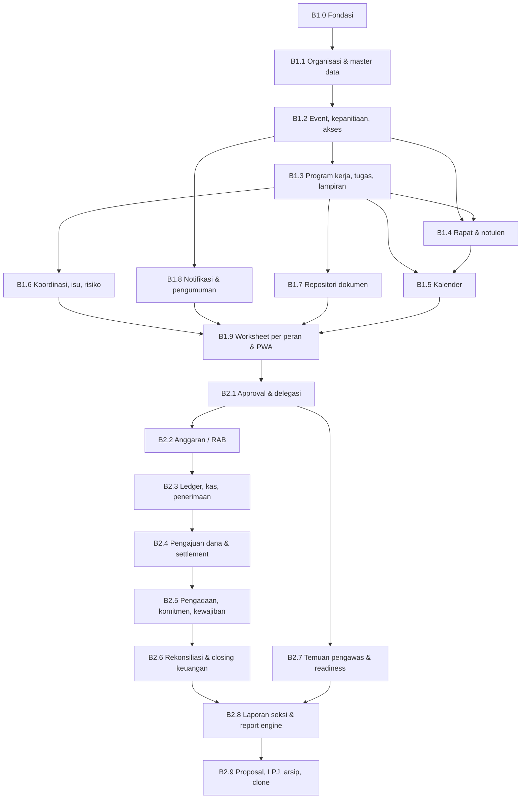

# Organizer — Implementation Plan (Phase 0)

**Status:** Disetujui 27 November 2026 (K-01 sampai K-04). Pengerjaan berjalan; status tiap batch ada di tracker.
**Tanggal audit:** 27 November 2026
**Sumber requirement:** [organizer.md](organizer.md) (master spec v1.0)
**Acuan UI/UX:** [ui-ux_brief.md](ui-ux_brief.md)
**Dokumen pendamping:** [DATA_MODEL.md](DATA_MODEL.md), [DEVELOPMENT_TRACKER.md](DEVELOPMENT_TRACKER.md)

Dokumen ini menjelaskan kondisi repository saat ini, selisihnya terhadap master spec, keputusan arsitektur yang diusulkan, dan urutan pengerjaan per batch. Semua yang bertanda **(usulan)** atau tercantum di bagian 10 belum final sampai dikonfirmasi.

---

## 1. Ringkasan

- Repository adalah boilerplate login + master user/role/permission. Belum ada satu pun entitas domain Organizer.
- Stack yang terpasang cukup untuk membangun seluruh baseline tanpa mengganti framework. Dua paket tambahan (PDF dan Excel) baru diperlukan di Phase 2 dan membutuhkan persetujuan.
- Role saat ini bersifat global. Spec membutuhkan hak akses per event dan per seksi, sehingga lapisan otorisasi event harus dibangun sendiri di atas yang sudah ada. Ini pekerjaan fondasi paling penting di Phase 1.
- Pekerjaan dibagi menjadi 10 batch di Phase 1 dan 9 batch di Phase 2. Setiap batch berdiri sendiri: punya migration, validasi, otorisasi, UI, dan test, lalu direview sebelum batch berikutnya dimulai.
- Ada 14 keputusan bisnis dan teknis yang belum ditetapkan (bagian 10). Empat di antaranya menghalangi Batch 1.0–1.2 dan sebaiknya dijawab lebih dulu.

---

## 2. Yang diperiksa

| Area | File / perintah | Hasil |
|---|---|---|
| Dependency PHP | `composer.json`, `composer show --direct` | Laravel 13.24.0, PHP 8.4.17, Jetstream 5.5.3 (stack Livewire), Livewire 4.3.5, Sanctum 4.3.3, spatie/laravel-permission 8.3.0, yajra/laravel-datatables 13.0.0, elegantweb/sanitizer 2.4.0 |
| Dependency dev | sama | PHPUnit 12.5.33, Pint 1.30.4, Boost 2.5.3, Pail, Sail, Faker, Mockery |
| Dependency JS | `package.json` | Vite 8, Tailwind 3.4, axios. Tidak ada framework JS |
| Routing | `routes/web.php`, `routes/api.php`, `bootstrap/app.php` | Dashboard dan master user/role/permission. Middleware `auth:web` + sesi Jetstream + `verified` + `can:<permission>` per route. Tidak ada middleware kustom |
| Controller | `app/Http/Controllers/**` | 5 controller. Validasi inline dengan `Validator::make`, sanitasi dengan `Sanitizer`, respons JSON `{status, data}` |
| Model | `app/Models/User.php` | Hanya `User` (trait `HasRoles`, `HasApiTokens`, `TwoFactorAuthenticatable`) |
| Migration | `database/migrations/*`, `php artisan migrate:status` | 6 migration, semuanya sudah dijalankan di database dev. ID bertipe bigint auto-increment. `users.username` wajib dan unik |
| Seeder | `database/seeders/UserSeeder.php` | 14 permission berpola `modul.aksi`, role `Super Admin`, satu user admin |
| Otorisasi | `config/permission.php` | `teams` = `false`. Tidak ada Policy maupun Gate kustom |
| Auth | `config/fortify.php`, `config/jetstream.php` | 2FA, update profil, update password aktif. Registrasi, reset password, verifikasi email, teams, API token, foto profil nonaktif |
| Layout dan UI | `resources/views/layouts/main_layout.blade.php`, `resources/views/master/*`, `public/assets/**` | Tema Metronic (Bootstrap 5, dark sidebar). JS per halaman di `public/assets/js/master/*.js` memakai jQuery + DataTables server-side |
| Plugin frontend tersedia | `public/assets/plugins/custom/` | fullcalendar, jkanban, vis-timeline, jstree, formrepeater, datatables, tinymce, ckeditor, cropper, fslightbox, leaflet, flotcharts |
| Konfigurasi | `config/*.php`, driver non-rahasia di `.env` | MySQL (dev), queue dan cache `database`, sesi `file`, filesystem `local` (root `storage/app/private`), mail `log`, broadcast `log`, timezone `UTC`, locale `en` |
| Test | `phpunit.xml`, `tests/**`, `php artisan test --compact` | SQLite in-memory. 36 test: 23 lulus, 12 dilewati, 1 gagal |
| Aturan proyek | `AGENTS.md`, `.agents/skills/**`, `.ai/rules` | Pedoman Laravel Boost aktif. Direktori `.ai/rules` belum ada |

Nilai rahasia di `.env` tidak dibaca; hanya nama driver yang diperiksa.

---

## 3. Existing vs required

| Kebutuhan spec | Kondisi sekarang | Selisih |
|---|---|---|
| Login, sesi, CSRF, 2FA | Ada (Fortify + Jetstream) | Alur undangan anggota dan reset password belum aktif |
| User, role, permission global | Ada (spatie) | Dipakai untuk level organisasi; perlu role `Organization Admin` dan permission baru |
| Organization scope | Tidak ada | Tabel `organizations` dan kolom `organization_id` |
| Direktori anggota tanpa akun | Tidak ada | `users` dengan akses login opsional (K-15) |
| Event, kepanitiaan, seksi | Tidak ada | Seluruh domain MOD-02 |
| Hak akses per event/seksi | Tidak ada | Assignment per event, resolver ability, Policy, middleware konteks event |
| Policy dan Form Request | Tidak ada | Diperkenalkan untuk modul baru (bagian 4.3) |
| Audit log | Tidak ada | Tabel `audit_logs` dan service pencatat |
| Penyimpanan file privat | Disk `local` sudah privat | Tabel dokumen, versi, tautan, dan route unduh berotorisasi |
| Notifikasi in-app | Tidak ada | Tabel `notifications` bawaan Laravel, inbox, preferensi |
| Queue | Driver `database`, tabel `jobs` ada | Worker dan pemantauan failed job perlu disiapkan saat deploy |
| Kalender, kanban, timeline | Plugin JS tersedia di tema | Backend dan halaman |
| Keuangan, approval, pengadaan | Tidak ada | Seluruh Phase 2 |
| PDF dan Excel | Tidak ada paket | Perlu persetujuan dependency (bagian 9) |
| PWA | Tidak ada manifest/service worker | Shell PWA di Batch 1.9 |
| Bahasa Indonesia, zona waktu | Locale `en`, timezone `UTC`, tidak ada folder `lang/` | Locale `id`, pesan validasi Indonesia, tampilan Asia/Jakarta |
| Test isolasi antar-event | Tidak ada | Dibuat sejak Batch 1.2 |

---

## 4. Keputusan arsitektur (usulan)

### 4.1 Frontend

Modul baru mengikuti pola yang sudah ada: Blade yang meng-extend `layouts.main_layout`, komponen Metronic/Bootstrap, satu file JS per halaman, DataTables server-side untuk tabel, dan AJAX JSON untuk aksi. Livewire terpasang tetapi tidak dipakai untuk modul baru supaya hanya ada satu pola. Alasannya: seluruh halaman kustom sekarang memakai pola ini, dan plugin tema (kalender, kanban, timeline) siap dipakai.

Tampilan mengikuti [ui-ux_brief.md](ui-ux_brief.md):

- Struktur halaman (header, panel, toolbar, kartu statistik) memakai kelas `ui-*` di `public/assets/css/ui.css`: dominan putih, border tipis `#dcdcde`, tanpa shadow, radius `0.475rem`, jarak antarblok `1.5rem`.
- Aksi dan status memakai kelas Metronic (`btn-primary`, `badge-light-*`). Warna brand tidak dipakai untuk mewarnai panel.
- Setiap halaman daftar mengikuti pola header + toolbar + tabel + modal (brief bagian 6), halaman detail mengikuti bagian 7, dashboard mengikuti bagian 8.
- Satu file JS per halaman dengan modul `KTxxx`, DataTables server-side, form AJAX dengan indikator tombol dan dialog SweetAlert.

Hal yang berbeda atau tidak tercakup brief:

| Hal | Perlakuan |
|---|---|
| Spec 2.3 meminta nuansa warm-neutral; brief menetapkan netral abu-abu dengan aksen biru | Brief yang dipakai |
| Brief menulis respons gagal ditangani di callback `success` (`res.status === false`) | Envelope `{status, data}` tetap, tetapi kegagalan datang dengan kode HTTP 422/403/409 (K-02) dan ditangani `OrganizerHttp` |
| Brief tidak membahas layout mobile/PWA | Diturunkan dari token warna, tipografi, dan radius yang sama di Batch 1.9 |
| `flatpickr-id.js` dan blok CSS perbaikan modal `lg`/`xl` berasal dari project sumber brief dan tidak ada di repo ini | Ditambahkan saat halaman pertama yang membutuhkannya dibuat, atau disalin dari project sumber bila tersedia |
| Brief menyebut Laravel 12, Livewire 3, dan logo per tenant | Tidak berlaku; repo ini Laravel 13 dan satu organisasi |

Tiga penyimpangan dari pola controller lama berlaku untuk modul baru, lihat 4.3.

### 4.2 Lapisan kode

| Lapisan | Lokasi | Tanggung jawab |
|---|---|---|
| Controller | `app/Http/Controllers/Organization/*`, `app/Http/Controllers/Event/*` | Menerima request, memanggil Policy dan Action, mengembalikan view/JSON. Tanpa business logic |
| Form Request | `app/Http/Requests/**` | Validasi dan pengecekan scope |
| Policy | `app/Policies/*` | Otorisasi per model, memanggil `EventAccess` |
| Action | `app/Actions/<Domain>/*` | Satu use case per kelas, dibungkus transaksi database. Folder `app/Actions` sudah ada (Fortify/Jetstream) |
| Service | `app/Services/*` | Logika lintas use case: `EventAccess`, `AuditLogger`, kalkulator keuangan dan progres |
| Model | `app/Models/*` (flat) | Relasi, cast, scope query |
| Enum | `app/Enums/*` | Status, tipe, dan katalog ability |

`app/Http/Requests`, `app/Policies`, `app/Enums`, `app/Services`, dan `app/Http/Middleware` adalah folder standar Laravel yang belum ada di repo. Persetujuan atas rencana ini dianggap sebagai persetujuan membuatnya.

### 4.3 Penyimpangan dari pola lama (disetujui, K-02)

| Pola lama | Usulan untuk modul baru | Alasan |
|---|---|---|
| Validasi inline di controller | Form Request | Spec bagian 10; validasi scope event harus konsisten dan dapat dites |
| Error dikembalikan dengan HTTP 200 dan `status: false` | Kode HTTP semestinya (422, 403, 409) dengan envelope `{status, data}` yang sama, ditangani satu helper JS bersama | Kegagalan otorisasi dan konflik harus dapat dibedakan oleh PWA dan test |
| Input di-`escape` oleh Sanitizer sebelum disimpan | Simpan apa adanya (hanya `trim`), escape saat output oleh Blade | Escape saat input menyebabkan escape ganda dan merusak data seperti nama atau narasi LPJ |

Halaman master user/role/permission yang sudah ada tidak diubah.

Penerapannya: Form Request modul baru meng-extend `App\Http\Requests\JsonFormRequest`; controller menjawab lewat `jsonSuccess()` dan `jsonFailure()` di base `Controller`; halaman mengirim AJAX lewat `OrganizerHttp` di `public/assets/js/organizer/http.js`.

### 4.4 Otorisasi dua tingkat

**Tingkat organisasi** memakai spatie-permission yang sudah ada (global, tanpa teams). Role: `Super Admin` (administrator teknis) dan `Organization Admin`. Permission baru mengikuti pola `modul.aksi`, misalnya `events.create`, `members.view`, `master-data.manage`, `audit.view`.

**Tingkat event** memakai tabel sendiri, bukan fitur teams spatie:

- `committee_roles`: master jabatan per organisasi (Ketua, Wakil Ketua, Sekretaris, Bendahara, Pengawas, Koordinator Seksi, Anggota Seksi) yang dapat ditambah.
- `committee_role_abilities`: pemetaan jabatan ke ability. Default di-seed, dapat diubah admin.
- `event_memberships` dan `event_role_assignments`: siapa menjabat apa, di event mana, di seksi mana.
- `delegations`: pelimpahan wewenang berbatas waktu (Phase 2).

Service `EventAccess` menjawab satu pertanyaan: *apakah user ini boleh melakukan ability X pada event Y (dan seksi Z)?* Semua Policy memanggilnya. Aturannya:

1. Deny by default. Tanpa membership aktif pada event, semua ditolak, termasuk unduhan file dan export.
2. Ability efektif adalah gabungan seluruh assignment aktif user pada event itu. Tidak ada "ganti role" di sesi, sehingga role switching tidak bisa dipakai untuk mengakali self-approval.
3. Assignment berscope seksi hanya berlaku pada seksi itu dan sub-seksinya.
4. Organization Admin melihat ringkasan lintas event; detail keuangan hanya jika diberi permission terpisah.
5. Pemisahan kewenangan (pengawas tidak mengedit data operasional, pengaju tidak menyetujui pengajuannya sendiri) diperiksa di Action, bukan hanya lewat pemetaan ability.

Alasan tidak memakai teams spatie: fitur itu hanya memberi scope satu tingkat (event), tidak mengenal seksi, masa berlaku, atau delegasi, dan mengaktifkannya mengubah primary key tabel permission yang sudah dipakai.

Katalog ability didefinisikan di kode sebagai enum `App\Enums\EventAbility` (karena kode yang memeriksanya), sedangkan pemetaan jabatan ke ability disimpan di database. Tidak ada role ID atau nama seksi yang di-hardcode; aturan ditulis terhadap `CommitteeRoleKind`. Setiap batch menambahkan ability untuk fitur yang mulai ditegakkannya.

### 4.5 Konteks event

- Semua route event berada di bawah `/events/{event}/...` dengan `scopeBindings()` sehingga child record yang bukan milik event tersebut menghasilkan 404.
- Middleware `event.access` memuat event, memastikan membership aktif, lalu membagikan konteks (event, assignment, ability) ke view.
- URL adalah satu-satunya sumber konteks event. Event switcher hanya berupa tautan; tidak ada "event aktif" di sesi yang bisa tertinggal saat berpindah event.

### 4.6 Uang dan ledger

- Nominal disimpan sebagai integer dalam satuan terkecil mata uang (untuk IDR: rupiah utuh) pada kolom `bigint`. Tidak ada float. Quantity boleh desimal; total baris dibulatkan dengan aturan eksplisit dan disimpan.
- Semua transaksi keuangan dicatat sebagai entri berimbang dalam "bucket" tetap (kas, biaya, pendapatan, uang muka, kewajiban, saldo awal). Jumlah entri dalam satu transaksi selalu nol. Ini bukan general ledger untuk pengguna; ini mekanisme internal agar saldo kas, biaya aktual, dan uang muka outstanding selalu dihitung dari satu sumber. Rincian di [DATA_MODEL.md](DATA_MODEL.md) bagian 6.
- Transaksi yang sudah diposting tidak dapat diubah atau dihapus. Koreksi dilakukan dengan transaksi pembalik.

### 4.7 Audit

Tabel `audit_logs` sendiri (append-only) yang ditulis oleh `AuditLogger` dari dalam Action. Tidak memakai paket tambahan karena kebutuhannya spesifik: jabatan efektif, event, alasan, dan correlation ID.

- Middleware `AssignCorrelationId` memberi setiap request satu correlation ID yang ikut tercatat di log, di entri audit, dan di job antrean yang dipicu request itu.
- Kolom pelaku, organisasi, dan event sengaja tanpa foreign key, dan nama pelaku disimpan sebagai salinan, agar entri audit tetap utuh setelah record yang dirujuk dihapus.
- Model yang menjadi subjek audit harus didaftarkan di morph map (`AppServiceProvider`).

### 4.8 Dokumen

File disimpan di disk privat `local`. Unduhan selalu lewat controller dengan Policy. Satu file dapat ditautkan ke banyak record lewat `document_links` tanpa menyalin fisik.

### 4.9 Mobile PWA

Backend, Policy, dan Action sama dengan web. Halaman mobile memakai layout Blade tersendiri (`layouts.mobile`) dengan navigasi bawah, di bawah prefix route `/m`. Manifest dan service worker ditulis manual tanpa paket. Draft offline hanya untuk data non-sensitif; approval dan posting keuangan wajib online.

### 4.10 Bahasa dan waktu

Locale aplikasi `id`, pesan validasi berbahasa Indonesia di `lang/id`. Waktu disimpan dalam UTC dan ditampilkan dalam zona waktu organisasi (default Asia/Jakarta). Kolom tanggal murni (tanggal transaksi, jatuh tempo) memakai tipe `date`.

---

## 5. Peta modul dan ketergantungan

| Modul spec | Batch |
|---|---|
| MOD-01 Master data | 1.1 (organisasi, anggota, jabatan, template seksi, kategori event, venue); 2.2 (kategori keuangan, satuan); 2.5 (vendor, aset) |
| MOD-02 Event & committee | 1.2; clone di 2.9 |
| MOD-03, 05, 07, 08 Worksheet | 1.9 (tampilan atas data Phase 1), diperluas di tiap batch Phase 2 |
| MOD-04 Wakil Ketua | 1.2 (assignment dan seksi supervisi); delegasi di 2.1 |
| MOD-06 Bendahara | 2.2–2.6 |
| MOD-09 Program & tugas | 1.3 |
| MOD-10 Koordinasi | 1.6 |
| MOD-11 Pengadaan | 2.5 (dasar); lanjutan di Phase 3 |
| MOD-12 Kalender | 1.5 |
| MOD-13 Rundown live | Phase 3 |
| MOD-14 Approval | 2.1 |
| MOD-15 Isu, risiko, keputusan | 1.4 (keputusan), 1.6 (isu, risiko) |
| MOD-16 Dokumen | 1.3 (inti lampiran), 1.7 (repositori) |
| MOD-17 Notifikasi | 1.8 |
| MOD-18 Progres & readiness | 1.3 (progres), 2.7 (readiness) |
| MOD-19 Dashboard organisasi | 1.9 (dasar), Phase 4 (analitik) |
| MOD-20 Report engine | 2.8 |
| MOD-21 Proposal & LPJ | 2.9 |
| MOD-22 Evaluasi & arsip | 2.8 (evaluasi), 2.9 (arsip) |
| MOD-23 Akses | 1.2, diperluas di tiap batch |
| MOD-24 Audit & keamanan | 1.0 (infrastruktur audit), diperluas di tiap batch |

---

## 6. Batch implementasi

Setiap batch selesai jika memenuhi Definition of Done di spec bagian 12: migration reversible, factory, Form Request, Policy, UI dengan state kosong/error, test yang benar-benar dijalankan, dan tracker diperbarui. Skenario `AC-xx` merujuk ke spec bagian 13.

### Phase 1 — Core committee management

#### Batch 1.0 — Fondasi
- **Status:** selesai, disetujui 27 November 2026. Rincian hasil di tracker bagian 9.
- **Lingkup:** locale `id` dan `lang/id`; tampilan zona waktu organisasi; helper JS bersama untuk AJAX dan error; `audit_logs` dan `AuditLogger`; morph map terpusat; kerangka navigasi organisasi vs event di layout; membuat seeder permission tidak destruktif; memperbaiki baseline test.
- **Kriteria terima:** seluruh test yang ada lulus; pesan validasi tampil dalam bahasa Indonesia; `AuditLogger` mencatat actor, aksi, objek, before/after dengan field sensitif disamarkan; menjalankan seeder dua kali tidak menghapus permission yang sudah dipakai role lain.
- **Test:** unit `AuditLogger` (redaksi, correlation ID); feature seeder idempoten.
- **Catatan:** mengubah perilaku seeder menyentuh test `test_it_replaces_legacy_permissions_when_seeding_the_boilerplate`. Perlu persetujuan (K-04).

#### Batch 1.1 — Organisasi dan master data
- **Status:** selesai 27 November 2026. Rincian di tracker bagian 10 dan 11.
- **Lingkup:** profil organisasi; unit/bidang pelayanan; direktori anggota (dengan atau tanpa akun); master jabatan panitia dan pemetaan ability; template seksi; kategori event; venue. Pencarian, filter, aktif/nonaktif, cek duplikasi.
- **Tabel:** `organizations`, `organization_units`, `members`, `committee_roles`, `committee_role_abilities`, `division_templates`, `event_categories`, `venues`.
- **Kriteria terima:** master yang sudah direferensikan tidak bisa dihapus, hanya dinonaktifkan; anggota bisa dibuat tanpa akun dan ditautkan ke akun belakangan; email/telepon duplikat ditolak dengan pesan jelas; seluruh akses dibatasi permission tingkat organisasi.
- **Test:** CRUD per master (happy path, validasi, 403); larangan hapus saat direferensikan; tautan anggota–akun unik.

#### Batch 1.2 — Event, kepanitiaan, dan kontrol akses
- **Status:** dikerjakan 27 November 2026, menunggu review. Rincian dan penyimpangan di tracker bagian 13.
- **Lingkup:** CRUD event dan tujuan/indikator; lifecycle status dan phase dengan histori; committee builder (jabatan, seksi/sub-seksi, koordinator, anggota, job description); undangan dan penerimaan; bagan organisasi; daftar event per user dan event switcher; `EventAccess`, Policy, middleware `event.access`; gate aktivasi.
- **Tabel:** `events`, `event_objectives`, `event_status_history`, `event_required_roles`, `divisions`, `event_memberships`, `event_role_assignments`, `invitations`.
- **Kriteria terima:** AC-01, AC-02, AC-03. Event tidak bisa diaktifkan jika jabatan wajib kosong; event tanpa wakil ketua sah. Pencabutan membership langsung menutup akses. Seksi induk harus dari event yang sama dan tidak boleh membentuk siklus.
- **Test:** matriks isolasi antar-event (URL, JSON, DataTables) untuk setiap route event; user dengan jabatan berbeda di dua event; gate aktivasi; undangan kedaluwarsa dan dipakai ulang; siklus seksi.

#### Batch 1.3 — Program kerja, tugas, aktivitas, dan inti lampiran
- **Lingkup:** program kerja per seksi; tugas/sub-tugas, milestone, dependency, assignee, review; transisi status yang sah; tampilan list, kanban, dan kalender; log aktivitas; unggah bukti; kalkulasi progres.
- **Tabel:** `work_programs`, `milestones`, `tasks`, `task_assignees`, `task_dependencies`, `task_reviews`, `activity_logs`, `documents`, `document_versions`, `document_links`.
- **Status:** dikerjakan 27 Nov 2026, menunggu review. Milestone menjadi kolom `tasks.is_milestone` dan review tercatat di `task_status_changes`; rincian di tracker bagian 15.
- **Kriteria terima:** tugas dengan review wajib tidak bisa `Completed` sebelum disahkan; reopen wajib beralasan; dependency lintas event dan siklus ditolak; progres = bobot tugas daun selesai ÷ bobot tugas daun yang berlaku, tugas dibatalkan dikecualikan, penyebut nol menghasilkan N/A; unduhan lampiran ditolak bagi non-anggota event.
- **Test:** unit transisi status dan kalkulator progres (termasuk parent/subtask tidak terhitung ganda); feature dependency, review, akses lampiran; validasi MIME dan ukuran.

#### Batch 1.4 — Rapat, notulen, keputusan
- **Lingkup:** rapat, agenda, undangan, RSVP, kehadiran; notulen berversi (draft, review, publish); decision log; action item dan konversinya menjadi tugas.
- **Tabel:** `meetings`, `meeting_agendas`, `meeting_attendees`, `meeting_minutes_versions`, `decisions`, `action_items`.
- **Kriteria terima:** AC-05. Konversi action item yang diulang tidak membuat tugas ganda. Notulen yang sudah publish hanya berubah lewat versi baru.
- **Test:** idempotensi konversi (termasuk request ganda); versi notulen; rekap kehadiran; akses rapat seksi.
- **Status:** dikerjakan 27 Nov 2026 tanpa undangan, RSVP, dan review notulen (keputusan pemilik produk); rincian di tracker bagian 21.

#### Batch 1.5 — Kalender terpusat
- **Lingkup:** kalender pribadi, seksi, event, dan organisasi; tampilan hari/minggu/bulan/daftar; agenda manual.
- **Tabel:** `calendar_entries` (hanya agenda manual). Rapat, jatuh tempo tugas, dan milestone dibaca langsung dari sumbernya oleh satu query service.
- **Kriteria terima:** bagian AC-20 untuk tugas dan rapat. Mengubah jadwal rapat langsung tercermin di kalender tanpa record duplikat; setiap item menautkan ke sumbernya; user hanya melihat item dari event yang diikutinya.
- **Test:** feature feed kalender per scope dan rentang tanggal; isolasi antar-event; event multi-hari.

#### Batch 1.6 — Koordinasi lintas seksi, isu, dan risiko
- **Lingkup:** request antar-seksi dengan alur status lengkap; pembuatan tugas dari request; isu (severity, eskalasi, penyelesaian); risiko (kemungkinan, dampak, mitigasi) dan konversi risiko menjadi isu.
- **Tabel:** `coordination_requests`, `coordination_request_items`, `coordination_fulfillments`, `issues`, `risks`.
- **Kriteria terima:** AC-06. Penolakan, revisi, dan pembatalan wajib beralasan. Ketua melihat request yang terhambat atau terlambat.
- **Test:** transisi status; hanya seksi tujuan yang bisa acknowledge/fulfil dan hanya seksi asal yang bisa verifikasi; relasi origin pada tugas turunan.

#### Batch 1.7 — Repositori dokumen
- **Lingkup:** penelusuran per event/seksi/kategori; metadata, tag, versi, status draft/final; pratinjau; pencarian; tingkat sensitivitas.
- **Tabel:** memperluas tabel dokumen dari Batch 1.3; `document_tags`.
- **Kriteria terima:** bagian AC-18 untuk lampiran privat. Dokumen final tidak bisa ditimpa, hanya diberi versi baru. Nama file disanitasi.
- **Test:** akses per sensitivitas; versi; penolakan tipe file berbahaya.

#### Batch 1.8 — Notifikasi, pengumuman, komentar
- **Lingkup:** inbox notifikasi (baca/belum, tautan aksi); preferensi; pengumuman umum/per jabatan/per seksi dengan konfirmasi baca; komentar kontekstual dengan mention.
- **Tabel:** `notifications` (bawaan Laravel), `notification_preferences`, `announcements`, `announcement_reads`, `comments`.
- **Kriteria terima:** notifikasi dikirim lewat queue setelah commit; pengiriman ulang job tidak menghasilkan notifikasi ganda; mention hanya untuk anggota yang berhak mengakses record; isi rahasia tidak masuk ke judul notifikasi.
- **Test:** idempotensi dispatch; target pengumuman per scope; mention ke non-anggota ditolak.

#### Batch 1.9 — Worksheet per peran dan shell PWA
- **Lingkup:** worksheet pribadi; control center Ketua; worksheet Sekretaris; workspace seksi; dashboard Pengawas (read-only); dashboard organisasi dasar; layout mobile, manifest, service worker, halaman offline, pembersihan cache saat logout.
- **Tabel:** tidak ada tabel domain baru. Worksheet adalah tampilan atas data yang sudah ada.
- **Kriteria terima:** AC-22; bagian AC-14 untuk draft catatan/foto dengan kunci idempotensi. Angka di worksheet sama dengan angka di halaman modul karena berasal dari query service yang sama. Pengawas tidak memiliki tombol atau endpoint ubah pada data operasional.
- **Test:** feature tiap worksheet per jabatan; kesamaan angka dengan service; unggah ulang dengan kunci sama tidak membuat record kedua; pengecekan manual instalasi dan pembaruan PWA di perangkat target.

### Phase 2 — Finance, governance, and reporting

#### Batch 2.1 — Approval engine, delegasi, surat
- **Lingkup:** kebijakan approval per jenis pengajuan dan ambang nominal; snapshot aturan saat submit; inbox approval; keputusan, revisi, pembatalan, reassign; delegasi wewenang; pemakai pertama: program kerja dan surat keluar (dengan penomoran).
- **Tabel:** `approval_policies`, `approval_policy_steps`, `approval_requests`, `approval_request_steps`, `approval_decisions`, `delegations`, `delegation_abilities`, `correspondence`, `document_number_sequences`.
- **Kriteria terima:** AC-12. Perubahan kebijakan tidak mengubah approval yang sedang berjalan. Keputusan approval dan perubahan status domain terjadi dalam satu transaksi. Penomoran surat aman terhadap request bersamaan.
- **Test:** self-approval, approval ganda, delegasi kedaluwarsa atau melebihi wewenang pemberi; mutasi setelah disetujui ditolak; penomoran di bawah konkurensi.

#### Batch 2.2 — Anggaran (RAB)
- **Lingkup:** kategori keuangan dan satuan; baris RAB per seksi; rencana pendapatan; review dan konsolidasi Bendahara; persetujuan; versi dan diff revisi.
- **Tabel:** `financial_categories`, `units`, `budget_versions`, `budget_items`, `budget_lines`.
- **Kriteria terima:** AC-07. Hanya satu versi efektif per event. Versi yang disahkan terkunci.
- **Test:** unit pembulatan total baris; versi dan diff; kunci setelah disahkan.

#### Batch 2.3 — Ledger, akun kas/bank, penerimaan
- **Lingkup:** akun kas dan bank; layanan posting; penerimaan dana; pledge dan bantuan nonkas; transfer internal; reversal; buku kas.
- **Tabel:** `finance_accounts`, `finance_transactions`, `finance_entries`, `funding_pledges`, `in_kind_contributions`.
- **Kriteria terima:** AC-11, AC-21. Setiap transaksi berimbang. Pledge tidak menambah saldo kas. Identitas donatur hanya terlihat oleh yang berwenang.
- **Test:** invarian INV-01 sampai INV-05 (bagian 8); kunci idempotensi posting; reversal ganda ditolak.

#### Batch 2.4 — Pengajuan dana, pencairan, pertanggungjawaban
- **Lingkup:** pengajuan uang muka, reimbursement, dan kas kecil; verifikasi; reservasi anggaran; pencairan parsial; settlement per baris; pengembalian sisa.
- **Tabel:** `fund_requests`, `fund_request_lines`, `budget_reservations`, `disbursements`, `settlements`, `settlement_lines`, `expense_claims`, `expense_lines`.
- **Kriteria terima:** AC-08, AC-09. Uang muka outstanding tidak pernah negatif.
- **Test:** skenario Rp10 juta / Rp8 juta / Rp2 juta dari spec 6.3 sebagai test tetap; dua pengajuan bersamaan melebihi sisa anggaran (dijalankan di MySQL); pencairan ganda dengan kunci sama.

#### Batch 2.5 — Pengadaan dasar, komitmen, kewajiban
- **Lingkup:** vendor dan aset; permintaan kebutuhan; penawaran; pesanan; penerimaan barang (termasuk sebagian); komitmen; invoice dan pembayaran vendor; peminjaman aset.
- **Tabel:** `vendors`, `assets`, `resource_requests`, `resource_request_lines`, `quotations`, `procurement_orders`, `procurement_order_lines`, `goods_receipts`, `goods_receipt_lines`, `commitments`, `commitment_lines`, `payables`, `asset_reservations`, `asset_movements`.
- **Kriteria terima:** AC-10, AC-19. Pengajuan dana yang terkait pesanan tidak mereservasi anggaran dua kali.
- **Test:** konversi komitmen menjadi biaya; satu biaya dan satu arus kas untuk pesanan–invoice–pembayaran; bentrok jadwal aset.

#### Batch 2.6 — Rekonsiliasi, closing keuangan, dashboard keuangan
- **Lingkup:** rekonsiliasi per akun; checklist closing; pengembalian saldo ke gereja; dashboard Bendahara; laporan keuangan di layar.
- **Tabel:** `reconciliations`, `financial_closings`.
- **Kriteria terima:** bagian keuangan AC-16. Angka dashboard, laporan, dan export berasal dari kalkulator yang sama. Kecukupan kas dan kecukupan anggaran ditampilkan terpisah.
- **Test:** closing ditolak jika ada uang muka outstanding, transaksi draft, atau rekonsiliasi gagal; pengecualian tercatat dengan alasan dan aktor.

#### Batch 2.7 — Temuan pengawas dan readiness
- **Lingkup:** temuan, respons, tindakan korektif, verifikasi, reopen; checklist kesiapan berbobot dengan verifikasi dan bukti.
- **Tabel:** `supervisory_findings`, `corrective_actions`, `readiness_checklists`, `readiness_items`, `readiness_verifications`.
- **Kriteria terima:** AC-13, AC-17.
- **Test:** unit kalkulator readiness (item kritis menandai event berisiko berapa pun skornya); pengawas tidak dapat mengubah ledger.

#### Batch 2.8 — Laporan seksi, evaluasi, report engine
- **Lingkup:** laporan seksi dan alur reviewnya; evaluasi target vs hasil; export PDF dan Excel/CSV dengan filter, cap waktu, dan label draft/disahkan; antrean untuk export besar.
- **Tabel:** `division_reports`, `evaluation_records`, `report_runs`.
- **Kriteria terima:** AC-18. Export hanya memuat kolom yang boleh dilihat pemintanya.
- **Test:** otorisasi per laporan; kesamaan angka export dengan kalkulator; render PDF dengan tabel panjang.
- **Prasyarat:** persetujuan paket PDF dan Excel (bagian 9).

#### Batch 2.9 — Proposal, LPJ, closing event, arsip, clone
- **Lingkup:** generator proposal dan LPJ dari data sumber; narasi yang dapat diedit; validasi kelengkapan; snapshot beku dan PDF saat disahkan; closing event; arsip read-only; reopen terbatas; clone event.
- **Tabel:** `proposal_versions`, `lpj_versions`, `document_templates`.
- **Kriteria terima:** AC-04, AC-15, AC-16. Data yang hilang ditandai, tidak diisi angka rekaan.
- **Test:** LPJ yang disahkan tidak berubah setelah master data diedit; clone tidak membawa transaksi, approval, peserta, atau LPJ; closing ditolak jika laporan seksi belum lengkap.

### Phase 3 dan 4 — garis besar

Dirinci setelah Phase 2 direview, dengan prioritas mengikuti kebutuhan event nyata (K-13).

- **Phase 3:** worksheet seksi khusus, registrasi dan QR check-in, rundown live (MOD-13), pengadaan lanjutan, custom worksheet builder, readiness lanjutan, web push. Masing-masing di balik feature flag.
- **Phase 4:** analitik lintas event, perbandingan historis, integrasi eksternal opsional, bantuan penyusunan narasi oleh AI dengan validasi manusia.

---

## 7. Batas otorisasi (default, dapat dikonfigurasi)

Matriks ini adalah seed awal `committee_role_abilities`, bukan aturan yang di-hardcode. Kode huruf: **L** lihat, **K** kelola (buat/ubah draft), **S** submit, **R** review/verifikasi, **A** approve, **P** posting, **–** tidak ada akses. Tambahan `(s)` berarti hanya seksi sendiri, `(t)` hanya yang ditugaskan kepadanya.

| Area | Org Admin | Pengawas | Ketua | Wakil Ketua | Sekretaris | Bendahara | Koordinator | Anggota |
|---|---|---|---|---|---|---|---|---|
| Profil dan pengaturan event | K | L | K | L | L | L | L | L |
| Struktur panitia dan seksi | K | L | K | L | K (data administrasi) | L | K(s) | L |
| Program kerja | L | L | A | R (seksi supervisi) | L | L | K, S (s) | L(s) |
| Tugas | L | L | K | K (seksi supervisi) | K (dari notulen) | K(t) | K(s) | K(t) |
| Rapat dan notulen | L | L | L | L | K, publish | L | K(s) | L (yang diundang) |
| Keputusan | – | K (pengawasan) | K | L | K | L | L | L |
| Koordinasi lintas seksi | – | L | L, eskalasi | L, eskalasi | L | L | K(s) | L(s) |
| Isu dan risiko | – | L | K | K | K | K | K(s) | lapor |
| Dokumen | sesuai tautan dan sensitivitas | L | L | L | K | K (keuangan) | K(s) | K(t) |
| RAB | – | A (RAB keseluruhan) | A | L | L | R, konsolidasi | K, S (s) | L(s) |
| Pengajuan dana | – | L | A (per ambang) | A jika didelegasikan | L | R, cairkan | K, S (s) | S jika diizinkan |
| Ledger, posting, rekonsiliasi | – | L | L | – | L (laporan) | K, P | – | – |
| Identitas donatur | – | sesuai izin | sesuai izin | – | – | L | – | – |
| Temuan pengawas | – | K, verifikasi | L, tugaskan | L | L | respons | respons(s) | – |
| Laporan seksi | – | L | A | L | R | L | K, S (s) | L(s) |
| LPJ | – | A | A | L | K | K (bagian keuangan) | L | L |
| Audit log | L (permission khusus) | L (event yang ditugaskan) | – | – | – | – | – | – |

Catatan:
- Administrator teknis (`Super Admin`) tidak otomatis menjadi approver bisnis dan tidak memperoleh akses data event dari jabatannya.
- Pengawas tidak pernah memiliki ability K atau P atas data operasional dan ledger.
- Approve atas pengajuan keuangan selalu ditolak jika penyetuju adalah pengajunya, apa pun jabatannya.

---

## 8. Invarian keuangan

Setiap invarian menjadi test tetap dan diperiksa ulang oleh perintah verifikasi yang bisa dijalankan kapan saja terhadap data event.

| ID | Invarian |
|---|---|
| INV-01 | Jumlah seluruh entri dalam satu transaksi yang diposting adalah nol |
| INV-02 | Saldo akun kas = saldo awal + kas masuk terposting − kas keluar terposting |
| INV-03 | Transfer internal tidak mengubah total pendapatan maupun biaya event; total kas event tetap |
| INV-04 | Transaksi terposting tidak pernah diubah atau dihapus; setiap transaksi dibalik paling banyak satu kali |
| INV-05 | Pledge dan bantuan nonkas tidak menghasilkan entri kas |
| INV-06 | Uang muka outstanding = dicairkan − settlement diakui − refund diterima, dan tidak pernah negatif |
| INV-07 | Pencairan uang muka menambah uang muka, bukan biaya. Settlement menambah biaya tanpa mengurangi kas |
| INV-08 | Sisa anggaran = disahkan − biaya aktual − komitmen outstanding − reservasi aktif; tidak ada komponen yang dikurangkan dua kali |
| INV-09 | Satu baris anggaran tidak memiliki reservasi aktif ganda untuk komitmen atau pengajuan yang sama |
| INV-10 | Reservasi dan komitmen tidak dapat dibuat melebihi sisa anggaran tanpa pengecualian yang diaudit, termasuk pada request bersamaan |
| INV-11 | Satu pesanan–invoice–pembayaran menghasilkan tepat satu pengakuan biaya dan satu arus kas keluar |
| INV-12 | Hanya ada satu versi anggaran efektif per event; versi yang disahkan tidak berubah |
| INV-13 | Angka dashboard, laporan, export, dan LPJ berasal dari kalkulator yang sama |

Contoh uji tetap (spec 6.3): anggaran konsumsi Rp25 juta, uang muka Rp10 juta, settlement Rp8 juta, refund Rp2 juta. Hasil: kas keluar bersih Rp8 juta, biaya aktual Rp8 juta, uang muka outstanding Rp0, sisa anggaran Rp17 juta.

---

## 9. Pendekatan pengujian dan dependency

### Pengujian

- **Kerangka:** PHPUnit 12 yang sudah ada, kelas test bergaya `test_it_...`, trait `LazilyRefreshDatabase`, factory untuk setiap model.
- **Unit:** kalkulator (progres, readiness, anggaran, kas, uang muka), transisi status, pembulatan uang, resolver `EventAccess`.
- **Feature:** setiap endpoint diuji untuk happy path, validasi gagal, tanpa login, tanpa ability, dan akses dari event lain.
- **Isolasi antar-event:** satu test berbasis data provider yang menelusuri seluruh route `/events/{event}/...` dan memastikan anggota event A ditolak di event B. Route baru otomatis ikut teruji.
- **Konkurensi:** SQLite in-memory tidak menguji row lock. Test bergrup `concurrency` (reservasi anggaran, penomoran surat, pencairan) dijalankan di database MySQL khusus test (K-05).
- **Browser:** belum ada alat E2E. Pengecekan UI dan PWA dilakukan manual dan dicatat di tracker; menambah Laravel Dusk adalah opsi (perlu persetujuan).
- **Data demo:** seeder terpisah berlabel demo, hanya untuk lingkungan development.

### Dependency yang diusulkan (belum dipasang)

| Kebutuhan | Kandidat | Dibutuhkan di | Catatan |
|---|---|---|---|
| Render PDF | `barryvdh/laravel-dompdf` | Batch 2.8 | Kompatibilitas dengan Laravel 13 diverifikasi sebelum dipasang |
| Export Excel | `maatwebsite/excel` | Batch 2.8 | Sama. Commit `db883a4` menyebut paket ini tetapi tidak ada di `composer.json` |
| Test browser | `laravel/dusk` | Opsional | Hanya jika E2E otomatis diinginkan |

Tidak ada dependency baru yang dibutuhkan untuk Phase 1.

---

## 10. Asumsi dan keputusan yang perlu dikonfirmasi

Kolom "Asumsi kerja" adalah yang akan dipakai jika tidak ada jawaban. K-01 sampai K-04 sudah disetujui; sisanya masih berupa asumsi.

| ID | Pertanyaan | Asumsi kerja | Memengaruhi |
|---|---|---|---|
| K-01 | Frontend modul baru: pola Metronic + Blade + AJAX, atau Livewire? | Metronic + Blade + AJAX. **Disetujui 27 Nov 2026** | 1.0 |
| K-02 | Setuju dengan tiga penyimpangan pola di 4.3 (Form Request, kode HTTP, tanpa escape saat input)? | Ya. **Disetujui 27 Nov 2026** | 1.0 |
| K-03 | Otorisasi event dengan tabel sendiri (4.4), bukan teams spatie? | Ya. **Disetujui 27 Nov 2026** | 1.2 |
| K-04 | Boleh mengubah `UserSeeder` agar tidak menghapus seluruh permission, beserta test terkait? | Ya. **Disetujui 27 Nov 2026** | 1.0 |
| K-05 | Tersedia database MySQL terpisah untuk test konkurensi? | Ya, dibuat lokal dengan nama berakhiran `_testing` | 2.1, 2.4 |
| K-06 | Apakah setiap event wajib memiliki Ketua, Sekretaris, Bendahara, dan Pengawas? Bolehkah lebih dari satu pemegang atau asisten? | Keempatnya wajib; Ketua/Sekretaris/Bendahara utama satu orang, asisten diperbolehkan; Pengawas boleh lebih dari satu | 1.2 |
| K-07 | Jumlah seksi minimum sebelum event diaktifkan? | Tidak ada minimum | 1.2 |
| K-08 | Bagaimana akun anggota dibuat: undangan email, dibuatkan admin, atau keduanya? Apakah email tersedia untuk semua panitia? | Keduanya; undangan lewat tautan bertoken yang juga bisa dibagikan manual | 1.1, 1.2 |
| K-09 | Ambang nominal approval, rantai penyetuju, dan aturan quorum jika pengawas lebih dari satu | Rute sesuai spec 6.5 tanpa ambang; quorum pengawas "salah satu cukup"; semuanya dapat dikonfigurasi | 2.1 |
| K-10 | Akun kas/bank: milik event atau rekening gereja bersama? Basis pengakuan penerimaan dan biaya? | Akun per event; penerimaan diakui saat kas diterima dan diverifikasi; biaya diakui saat bukti diverifikasi | 2.3–2.6 |
| K-11 | Penyimpanan uang sebagai integer rupiah utuh (tanpa sen)? | Ya | 2.2 |
| K-12 | Format penomoran surat, template proposal/LPJ, dan bentuk pengesahan | Format dapat dikonfigurasi per organisasi; template default mengikuti struktur spec MOD-21 | 2.1, 2.9 |
| K-13 | Seksi khusus mana yang diprioritaskan di Phase 3? Perlukah registrasi publik dan QR? | Ditentukan setelah Phase 2 | Phase 3 |
| K-15 | Anggota dan User digabung atau tetap terpisah? | **Diputuskan 27 Nov 2026: digabung ke `users`, akses login opsional** (tracker bagian 11) | 1.2 |
| K-14 | Perkiraan jumlah user dan event, kapasitas media, target perangkat/browser, hosting, backup, serta target RPO/RTO | Belum ada; dibutuhkan sebelum produksi | Deploy |

Asumsi lain yang dipakai dokumen ini:
- Baseline satu organisasi. Kolom `organization_id` tetap ada di tabel tingkat organisasi dan event, tetapi tidak ada tabel keanggotaan organisasi sampai multi-organisasi benar-benar dibutuhkan.
- Role `Super Admin` yang ada diperlakukan sebagai administrator teknis.
- Jetstream teams tetap nonaktif; kolom `users.current_team_id` tidak dipakai.

---

## 11. Risiko

| Risiko | Dampak | Mitigasi |
|---|---|---|
| Kebocoran data antar-event | Tinggi | Deny by default, `scopeBindings`, test isolasi otomatis untuk seluruh route sejak Batch 1.2 |
| Perhitungan keuangan ganda atau tidak konsisten | Tinggi | Satu ledger berimbang, satu set kalkulator, invarian sebagai test tetap dan perintah verifikasi |
| Race condition pada anggaran dan pencairan | Tinggi | Transaksi database dengan row lock, kunci idempotensi unik, test di MySQL |
| Aturan gereja belum ditetapkan | Sedang | Semua aturan sebagai konfigurasi dengan default di seed; keputusan dicatat di tracker |
| Lingkup terlalu besar untuk satu rilis | Sedang | Batch kecil yang direview satu per satu; Phase 3 di balik feature flag |
| Dua pola kode berdampingan (master lama vs modul baru) | Rendah | Halaman lama tidak diubah; konvensi modul baru dicatat di `.ai/rules` saat Batch 1.0 |
| Paket PDF/Excel belum mendukung Laravel 13 | Sedang | Verifikasi sebelum Batch 2.8; siapkan alternatif (CSV bawaan, render HTML siap cetak) |
| Perintah `db:refresh` dan seeder destruktif dijalankan tidak sengaja | Sedang | Tidak dijalankan oleh agen; diamankan di Batch 1.0 setelah disetujui |

---

## 12. Langkah setelah review

1. Review hasil Batch 1.4 (tracker bagian 21).
2. Batch 1.5 (kalender terpusat): rapat dan tenggat tugas dalam satu kalender.
3. Koreksi model data di [DATA_MODEL.md](DATA_MODEL.md) bila ada.
4. Pengerjaan berlanjut satu batch per iterasi, dengan tracker diperbarui di akhir setiap batch.
